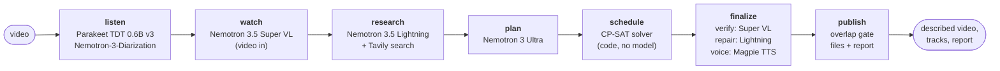

# Lull

Lull writes audio description for prerecorded video: short spoken lines that tell a blind or
low-vision viewer what is on screen and isn't said. It finds the pauses in the soundtrack,
writes each line to fit a pause, checks every claim in the line against the frames it
describes, voices the lines and publishes standard outputs:

- a WebVTT description track and an extended track;
- a described audio track and a described video;
- the script;
- a conformance report.

A person can review and edit every line in a studio before publishing. Lines that fail the
frame check are held for that person instead of being spoken.

- **Live site:** https://lull-omega.vercel.app
- **API:** https://lull-api-494617981995.us-central1.run.app (REST and MCP)
- **Demo video (under 3 minutes):** on the submission page (link added here once published)

## The problem

A student who can't see the screen hears a lecturer say "as you can see on this chart…" and
gets nothing. Captions don't help: what's missing is visual. Audio description fills that gap,
spoken in the pauses so it never covers the speaker.

It is required, not optional:

- **WCAG 2.1 and 2.2, success criterion 1.2.5 (level AA):** audio description for all
  prerecorded video in synchronised media.
- **ADA Title II (United States):** under the Department of Justice rule as amended on
  20 April 2026, state and local governments, including public universities, must meet
  WCAG 2.1 AA:
  - by **26 April 2027** for entities serving 50,000 people or more;
  - by **26 April 2028** for smaller ones.

  Course video behind a login is not exempt.
- **European Accessibility Act (Directive 2019/882):** since **28 June 2025**, audiovisual
  media services in the EU must carry access services, audio description among them.

Human audio description typically costs several dollars per minute of video, so most lecture
libraries have none. Language models alone place descriptions badly: on the timing-aware
measure of the REFRAMED study (COLM 2026), the best model scored 17.3 % against 61.2 % for
human describers. A wrong description is worse than none for someone who can't check it.

Lull splits the job:

- **Models write, and check:** NVIDIA Nemotron on Nebius Token Factory.
- **Code places the lines:** a constraint solver works inside pauses measured from the audio.
- **A person signs off.**

## How it works



| Stage | What happens | Model or tool |
| --- | --- | --- |
| listen | Every word with its start and end, who speaks when. The pauses are the time between words, minus a 0.2 s guard on each side, with capacity counted in words at the voice's measured rate. | NVIDIA Parakeet TDT 0.6B v3 and Nemotron-3-Diarization, on NVIDIA NeMo-Speech.cpp |
| watch | Watches the video in windows and lists what a listener would miss, with times: actions, settings, on-screen text, charts. | `nvidia/Nemotron-3.5-Super-VL` on Nebius Token Factory |
| research | Picks names and terms worth checking and looks them up, so they're spelled right. | `nvidia/Nemotron-3_5-Lightning` + Tavily search |
| plan | Reads the whole video at once and writes, per visual event, candidate lines at up to three lengths with a priority. | `nvidia/Nemotron-3-Ultra-550b-a55b` |
| schedule | Assigns events to pauses to maximise what is conveyed, never over capacity, never after the visual it describes. | CP-SAT (Google OR-Tools), code only |
| finalize | Lints each line against description rules, splits it into claims and sentences, has the frames judge each one, cuts what isn't supported and checks again, voices the line and measures the real audio. | Super VL (verify), Lightning (repair, compress), NVIDIA Magpie TTS Multilingual |
| publish | Refuses to write anything if a voiced line overlaps speech; otherwise writes every file and the report. | code |

Every model call is logged with its tokens, latency and cost, and spend caps are checked
before each call. Research calls Tavily at runtime (up to 3 searches per hosted run); searches
are counted, not priced.

## Three guarantees, and how each is enforced

**1. It never talks over dialogue.**
- The pauses come from measured word timings, not from a model.
- The solver keeps every line inside its pause's capacity.
- Each line is synthesised and its real duration measured. If it runs long, it is sped up by
  at most 10 % or shortened, and otherwise held.
- At publish, a gate refuses to write any file if a voiced line overlaps a recognised word or
  another line.
- Scope: this covers *recognised* speech. A sound the speech recogniser doesn't pick up is not
  protected (see Known limitations).

**2. Nothing is voiced unless its frame check passes.**
- Each line is split into atomic claims and judged sentence by sentence against the frames it
  describes.
- A claim that isn't visible, or is contradicted, is cut by the engine and the line is checked
  again. The cut never changes what the kept words say.
- A line that still fails is held for a person and never voiced.
- Scope: the judge is a model, so it can be wrong. The negative control measures how often it
  accepts a line against footage that doesn't show it (see Evaluation and
  [Known limitations of verification](engine/README.md#known-limitations-of-verification)).

**3. The report says only what the data says.**
- WCAG 1.2.3, 1.2.5 and 1.2.7 rows are computed from the run: overlap, held lines, coverage of
  the important events, and unused pauses next to undescribed content (WCAG failure F113).
- A row reads **met** only after a person has reviewed every published line. Until then it
  reads "met (automated checks)" or "needs review", with the reasons.
- Spend comes from the call ledger. Web searches are counted, never priced.

## Quick start

**Command line** (your own keys; needs ffmpeg 7+ and a NeMo-Speech.cpp server):

```sh
cd engine && uv sync
nemo-speech serve --host 127.0.0.1 --port 8089 \
  --asr-model parakeet-tdt --diar-model nemotron-3-diarization --tts-model magpie
export NEBIUS_API_KEY=…            # TAVILY_API_KEY is optional
uv run lull describe talk.mp4 --out runs/talk
```

**REST** (the hosted service: samples only, under a spend cap):

```sh
export LULL_API=https://lull-api-494617981995.us-central1.run.app
curl -s "$LULL_API/v1/samples"
curl -N "$LULL_API/v1/runs" -H "X-Lull-Client: web" -F sample=ed45 -F mode=standard
curl -s "$LULL_API/v1/runs/$RUN"                    # the run id from the first event
```

The `X-Lull-Client` header is required on what starts work. It makes browsers ask first, so
another site can't start runs from a visitor's browser.

**MCP**, for an AI agent. Add the hosted server to a client:

```json
{ "mcpServers": { "lull": { "type": "http", "url": "https://lull-api-494617981995.us-central1.run.app/mcp" } } }
```

Its tools are `list_samples`, `describe_video(sample_id, mode)`, `get_tracks(run_id)` and
`get_report(run_id)`. A description takes a few minutes and sends progress, so allow at least 5
minutes per call. Run `uv run lull mcp` locally to describe your own files; it adds
`review_queue`. The full reference is at https://lull-omega.vercel.app/developers.

**Embed the player** on any page:

```html
<script type="module" src="https://lull-omega.vercel.app/player.js"></script>
<lull-player src="…/video.mp4" descriptions="…/descriptions.vtt" described-audio="…/described-audio.m4a"></lull-player>
```

## Repository map

| Folder | What's in it |
| --- | --- |
| `engine/` | The `lull` command and pipeline (Python): stages, prompts, the scheduler, the spend ledger, tests. `engine/src/lull/api/` is the HTTP API and the MCP servers; `engine/docker/` is the container for Cloud Run (the API, NeMo-Speech.cpp with the speech models baked in, ffmpeg, Litestream). |
| `web/` | The website (Next.js): landing, try-it, recorded runs, studio, conformance reports, developer docs, benchmarks, and the `<lull-player>` web component (`web/player/`). |
| `eval/` | The evaluation: Suite A (synthetic lectures with a hidden answer key), Suite B (against human description), the verifier controls, and the report that writes `RESULTS.md`. |

Each folder has its own README with setup and tests.

## Evaluation

Every number below comes from a script in `eval/` that anyone can re-run. Each result names the
commit, the model ids and the pre-registration it was scored against. The full results, with
95 % intervals, deviations and known failures, are in [eval/RESULTS.md](eval/RESULTS.md).

**Suite A** is 12 synthetic lectures (8.8 minutes) whose narration leaves facts on the slides
unsaid. The answer key was committed and tagged (`suite-a-prereg`) before the scorer or any
pipeline call.

| Measure | Result |
| --- | --- |
| Visual facts described (standard track) | 2.6% (6 of 235; 95% CI 0.5–5.1%) |
| Visual facts described (with the extended track) | 14.0% (33 of 235; 95% CI 7.9–19.7%) |
| Unsupported claims in published lines | 18.1% of claims (19 of 105; 95% CI 4.0–37.2%). A supplementary breakdown, made after the scored run without new calls, finds one real misreading among the 19; the others are paraphrases the key's exact-wording rule does not accept, title fragments, or whole-sentence claims repeating atomic ones |
| Seconds of description over narration | 0.0 s |
| Decoys stated | 0 of 48 |
| Model spend per minute of video | $0.027 (95% CI $0.024–0.030) |
| Processing time per minute of video | 79 s (95% CI 74–85 s) on the recorded hardware |

**Suite B** compares Lull with human audio description of Elephants Dream (two describers) and
three USGS videos. It is pre-registered under `suite-b-prereg-2`. Result: on Elephants Dream Lull conveyed 0.8% of Hunt's and 1.3% of Pfeiffer's described facts near the moment they describe (2.4% and 3.3% anywhere in the film); on the USGS videos, 4.5% (7.1% anywhere). The two human describers convey 38.8% and 42.7% of each other's facts. Lull conveys little of what the human describers chose to say.

**Verifier controls** are pre-registered under `controls-prereg-2`.
- Negative control (lines checked against footage that doesn't show them): 13.2% (5 of 38; 95% CI 2.6–23.7%), an upper bound; 0 of 11 discriminative false accepts on Suite A accepted.
- Ablation (Suite A with the frame check off): with the frame check off, 5.9% of voiced statements were unsupported against 11.0% with it on (difference −5.1 points, 95% CI −18.4 to +4.5), and recall with the extended track was 14.9 points higher (95% CI +6.2 to +23.1). On these synthetic lectures the frame check did not measurably reduce unsupported statements, and it cost recall.

## Known limitations

- **English only:** descriptions are written and voiced in English.
- **Short live runs:** the hosted service describes clips of up to 60 seconds and 30 MB
  (samples up to 45 s), one at a time, under a spend cap. Longer videos run on the command line.
- **Recognised speech only:** the overlap guarantee covers speech the recogniser picks up.
  Singing, whispering or overlapping crowd speech may be missed, and other sounds are not
  protected.
- **The frame judge is a model.** It can accept a line it shouldn't, and the negative control
  measures how often. See
  [Known limitations of verification](engine/README.md#known-limitations-of-verification).
- **Description is selective.** Lull leaves important moments undescribed when no pause can
  hold them. The report names them (coverage and F113), and the extended track covers some by
  holding the picture.
- **No identification of people.** People are described by appearance until the video names
  them.
- **Synthetic voice.** A human-voiced version is not offered.
- **Not a replacement for review.** A WCAG row reads "met" only after a person has reviewed
  every line.

The evaluation's own limitations are listed in [eval/README.md](eval/README.md), and the
honesty ledger is [CLAIMS.md](CLAIMS.md).

## Licences and credits

**Code:** Apache License 2.0 ([LICENSE](LICENSE)).

**Models** (called at runtime; not redistributed here, except inside the container image as
noted):

| Model | Role | Licence |
| --- | --- | --- |
| NVIDIA Nemotron 3.5 Super VL (`nvidia/Nemotron-3.5-Super-VL`) | watching, frame verification | OpenMDW-1.1 (its model card); served by Nebius Token Factory under its terms |
| NVIDIA Nemotron 3 Ultra (`nvidia/Nemotron-3-Ultra-550b-a55b`) | planning; the evaluation's judge | per its model card; served by Nebius Token Factory under its terms |
| NVIDIA Nemotron 3.5 Lightning (`nvidia/Nemotron-3_5-Lightning`) | research terms, repairs, compression | per its model card; served by Nebius Token Factory under its terms |
| NVIDIA Parakeet TDT 0.6B v3 | speech recognition | CC BY 4.0 |
| NVIDIA Nemotron-3-Diarization | who speaks when | OpenMDW |
| NVIDIA Magpie TTS Multilingual 357M | the voice of the descriptions | NVIDIA Open Model License |

The container image bundles the speech models in the builds NVIDIA publishes for
NeMo-Speech.cpp (Apache-2.0).

**Software:**
- NVIDIA NeMo-Speech.cpp (Apache-2.0);
- Google OR-Tools CP-SAT (Apache-2.0);
- FFmpeg (the container uses a GPL build);
- Litestream (Apache-2.0);
- Tavily search API (a service).

The website's fonts (Newsreader, Figtree, IBM Plex Mono) are under the SIL Open Font License.

**Media:**
- *Elephants Dream* (2006), © Orange Open Movie Team / Blender Foundation, CC BY 2.5. It is
  the recorded run on the site and the `ed45` sample.
- *Big Buck Bunny* (2008), Blender Foundation, CC BY 3.0: the `bbb45` sample.
- *Tears of Steel* (2012), Blender Foundation, CC BY 3.0: the `tos45` sample, and the only real
  clip description quality was developed on (besides clips made for the tests).
- USGS videos (public domain; their music used with permission): used in the evaluation only,
  and not in this repository.

**Reference descriptions** (evaluation only, in `eval/suite_b/`):
- Silvia Pfeiffer's Elephants Dream description track, CC BY 4.0;
- JJ Hunt's Elephants Dream description track and recording, CC BY-SA 4.0. What is derived
  from it is shared alike.

**Research cited:**
- REFRAMED (COLM 2026);
- "What, When, and How" (2026), which schedules audio description under timing constraints
  and is the closest prior work to Lull's scheduler.

**Synthetic voice.** Lull's descriptions are spoken by NVIDIA Magpie TTS, a synthetic voice.
Every report and script says so, and the described audio track carries it in its metadata.
The narration of the demo video is also a synthetic voice.
